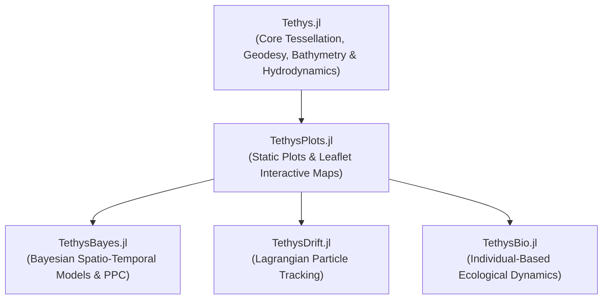

# TethysPlots.jl

`TethysPlots.jl` is the unified visualization, mapping, and geospatial diagnostics
engine for the Tethys oceanographic, ecological, and spatial partitioning ecosystem.
It delivers both publication-grade static vector graphics (via `Plots.jl`) and
self-contained, standalone interactive GIS dashboards (via `Leaflet.js`).

---

## Architectural Role in the Tethys Ecosystem



---

## Key Features

* **Polygon & Mesh Choropleths**:
  Automated quantile scaling, divergent center-zero color palettes, and colorbar legends
  over arbitrary polygonal geometries or regular planar hexagonal lattices (`choropleth`,
  `plot_hexagonal_field`).

* **Spatial Partitioning & Graph Visualizations**:
  Direct visualization of computational domains, boundary hulls, observation points,
  unit centroids, and spatial adjacency graphs \$W\$ (`spatial_graph_plot`, `plot_partition`).

* **Continuous Surface Reconstruction via Matérn-3/2 Kernels**:
  Transforms discrete point observations \$\mathbf{x}_i\$ into a continuous spatial random
  field over a regular 2D domain grid using regularized dual-basis Matérn-3/2 kernel interpolation:
  ```math
  z(\mathbf{x}_0) = \bar{z} + \sum_{i=1}^N \alpha_i \cdot \left(1 + \frac{\sqrt{3}\|\mathbf{x}_0 - \mathbf{x}_i\|}{\ell}\right) \exp\left(-\frac{\sqrt{3}\|\mathbf{x}_0 - \mathbf{x}_i\|}{\ell}\right)
  ```
  with dual weights \$\boldsymbol{\alpha} = (\mathbf{K} + \lambda \mathbf{I})^{-1}(\mathbf{z} - \bar{z})\$.

* **Advection & Velocity Vector Fields**:
  Computes and displays directed movement flux and advective drift arrows over habitat
  gradients or Markov transition probability matrices \$\Gamma\$ (`plot_advection_arrows`,
  `plot_velocity_field`).

* **Hydrodynamic Diagnostics**:
  * Brunt-Väisälä buoyancy frequency \$N^2\$ and practical salinity horizontal slices with
    water-column mean profiles (`plot_hydrodynamic_stratification`).
  * Turbulent vertical eddy diffusivity \$\kappa_v\$ and viscosity \$\nu_v\$ diagnostics
    (`plot_hydrodynamic_diffusion`).
  * 2D vertical cross-sections across transect corridors with seafloor bathymetry bedrock
    masking (`plot_hydrodynamic_section`).

* **Interactive GIS Web Dashboards (Leaflet.js)**:
  Zero-dependency HTML exports embedding full interactivity:
  * Pan, zoom, tile switcher, dynamic tooltips, and interactive legends.
  * Time-slider animation panels for spatio-temporal predictions (`leaflet_spacetime_map`).
  * Current density & ecological pinch-point visualizations (`leaflet_current_density_map`).

---

## API Reference

* `choropleth(polygons, values; mode=:plots, cmap=:viridis, ...)`: Renders polygon choropleth.
* `spatial_graph_plot(centroids, g; polygons=..., ...)`: Renders areal graph and boundary hull.
* `plot_partition(au; mode=:plots, ...)`: Renders spatial partitioning mesh and connectivity.
* `plot_hexagonal_field(values, au; mode=:plots, ...)`: Renders scalar field on hexagonal mesh.
* `plot_spatial_surface(coords, values; grid_res=150, ...)`: Reconstructs continuous surface.
* `plot_advection_arrows(au; hsi=..., velocity=..., ...)`: Quiver vector field of directed drift.
* `plot_hsi_choropleth(hsi, au; ...)`: Habitat suitability index map.
* `plot_diffusion_map(diffusion, au; ...)`: Spatial diffusion/dispersal rate map.
* `plot_residence_time_map(Gamma, au; ...)`: Stationary distribution \$\pi\$ under Markov kernel.
* `plot_hydrodynamic_stratification(hydro_data, au; depth_level=1, ...)`: Ocean stratification.
* `plot_hydrodynamic_diffusion(hydro_data, au; depth_level=1, ...)`: Turbulent eddy diffusivity.
* `plot_hydrodynamic_section(hydro_data, au; var=:temperature, ...)`: Vertical transect cross-section.
* `timeseries_ci(x, mean, lower, upper; ...)`: Time series with credible interval ribbon.
* `save_plot(p, path)`: Saves static figure (`.png`, `.pdf`) or interactive HTML (`.html`).
* `save_html(m, path)`: Saves interactive `LeafletMap` HTML document.
